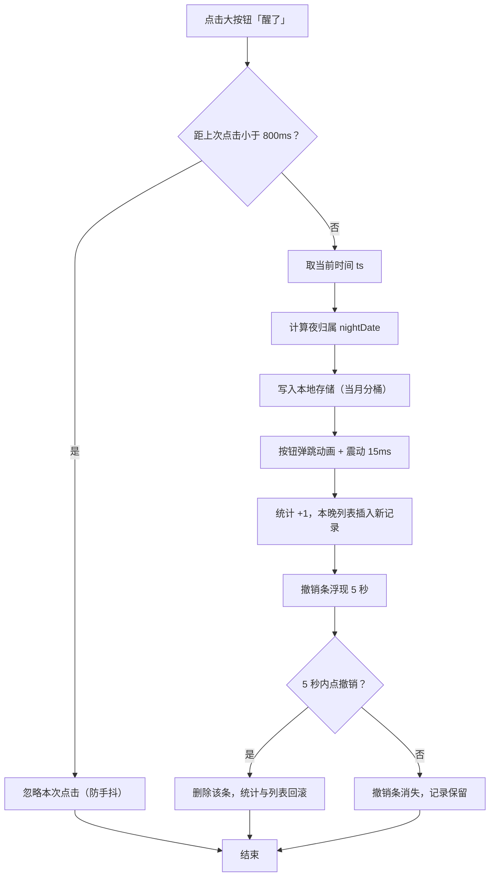
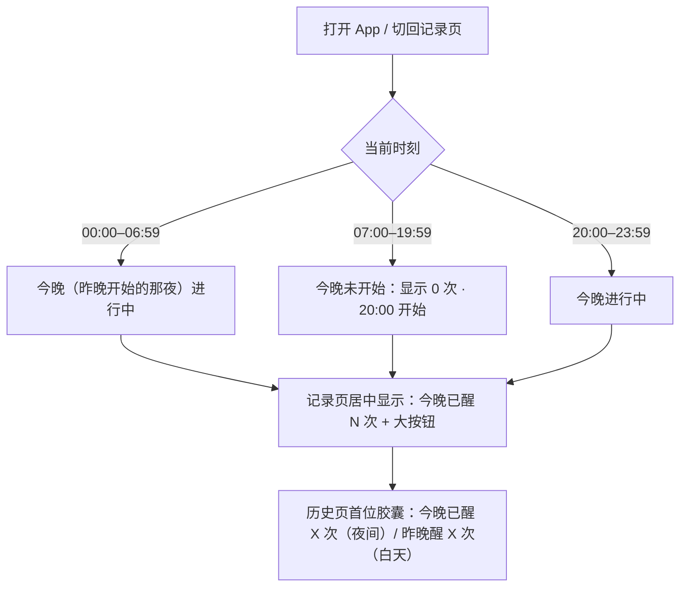
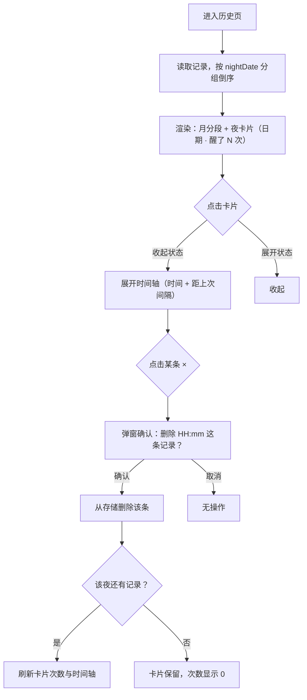
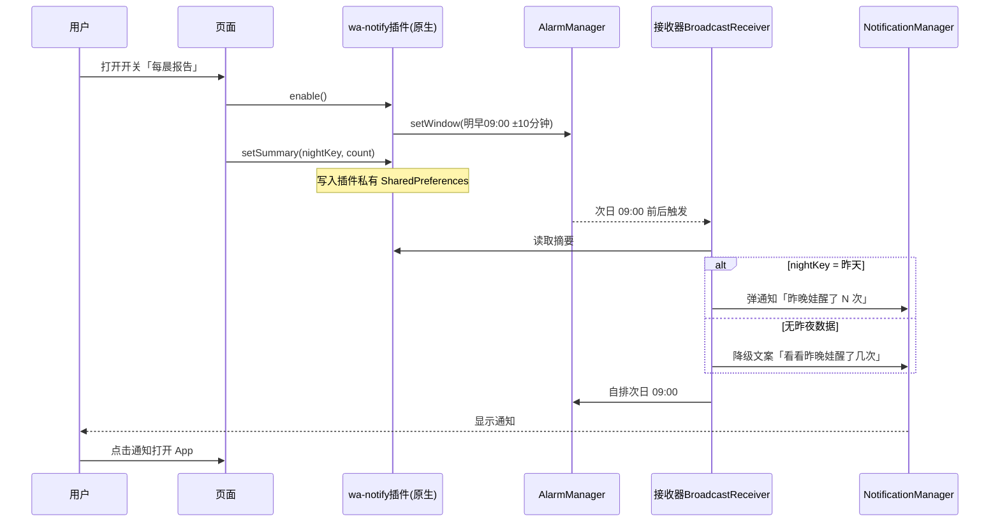
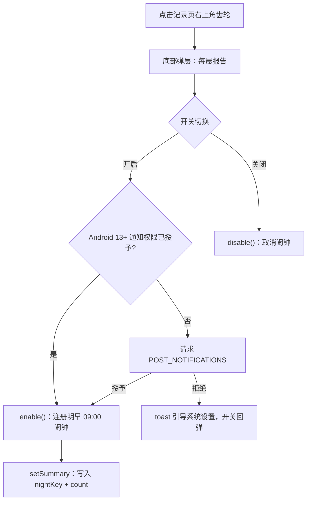

# 《娃醒了》设计方案与原型

- 日期：2026-10-23
- 技术栈：uni-app x（UTS，编译原生）
- 状态：MVP 已实现（2026-10-23，详见 §8 实施记录），待 HBuilderX 编译与真机验证；§7 问题按默认决策落地

## 0. 需求记录（原文留痕）

> 我想用uni-app x来开发一款APP，app的功能仅记录宝宝晚上醒的次数，app名字就叫娃醒了。设计应该非常简单，tab页只有两个，一个是记录，一个是历史。记录界面里只有一个增加按钮，点击了自动记录时间，历史记录按天分类，点击展开每天醒的次数和历史等等。

逐条拆解：

1. 技术栈：uni-app x（UTS 语言，编译为原生 App）。
2. 功能边界：仅记录"宝宝晚上醒的次数"，不做其他育儿功能。
3. 名称：娃醒了。
4. 设计原则：非常简单。
5. 信息架构：两个 tab —— 记录、历史。
6. 记录页：只有一个增加按钮；点击自动记录当前时间，无任何输入。
7. 历史页：按天分类；点击某天展开该天醒的次数与明细。

歧义标注与默认决策（待用户确认，见 §7）：

| 歧义点 | 默认决策 | 备选 |
| --- | --- | --- |
| "晚上"的边界、跨 0 点算哪天 | 凌晨 00:00–06:59 的醒来归"昨晚"（§3.3） | 界点可配置（MVP+） |
| 白天误点 | 照常记录、计入当天，可删除 | 白天记录不计入次数 |
| 误点撤销 | 记录后 5 秒内一键撤销 + 列表内删除 | 不做（不建议） |
| 多宝宝 | 不支持（单宝宝） | 远期 |
| 云同步/导出 | 不做，纯本地 | MVP+ 导出 |
| 平台 | Android 先行 | iOS 同批待验证 |

## 1. 产品概述

一句话：半夜半梦半醒也能一步记下"娃又醒了"，早上起来一眼看到昨晚醒了几次。

目标用户：0~2 岁宝宝的家长（给自己用）。

核心场景：

- S1 凌晨 2:40 娃哭醒：摸手机点亮 → app 停留在记录页 → 瞎点大按钮 → 成功记录，继续哄睡。全程无输入、无确认、不需要看清屏幕。
- S2 早上起床：打开 app 看"昨晚醒了 3 次"，顺手翻最近一周的趋势。
- S3 回顾：翻历史看具体每天每次几点醒的、间隔多久。

## 2. 信息架构

```text
娃醒了
├── Tab1 记录（首页，一键记录 + 今晚统计）
└── Tab2 历史（按夜分组 + 展开明细 + 汇总）
（无登录、无网络、无推送、不申请任何权限）
```

MVP 无二级页面、无设置页。

## 3. 交互设计（重点）

### 3.1 记录页（Tab1）

v2 改版（§9）：整页垂直居中，只留"统计 + 按钮"两个元素。

1. 顶栏：右上角日期"10月24日 · 周六 · 凌晨" + 小齿轮（每晨通知开关，§10）（导航栏标题为 app 名）。
2. 垂直居中区：统计（"今晚已醒 N 次"大数字 + 夜窗口副行）→ 超大圆形按钮"醒了 / 点一下就好"（约屏宽 60%）。
3. 按钮正下方条件区域：记录后 5 秒内显示撤销条"已记录 02:41 · 撤销"；其余时间显示"上次记录 HH:mm"（有记录时）。

操作流与反馈：

- 点击按钮 → 防抖判断（800ms 内重复点击忽略，防手抖；不拦截真实连续醒）→ 记录当前时间 → 震动 + 按压反馈 → 数字 +1 → 撤销条出现 5 秒。
- 撤销：点撤销条直接删除该条（无二次确认，误撤可再点一次按钮恢复）。
- 本晚明细与删除：不在记录页，去历史页对应夜卡片展开后逐条删除（§3.2）。
- 白天状态：数字显示今晚已记录数（通常 0），副行"…… · 20:00 开始"；点击按钮照常记录（归今晚），可撤销。
- 深浅色：MVP 固定深色主题（深夜核心场景优先、避免刺眼）；浅色主题列入 MVP+。

### 3.2 历史页（Tab2）

自上而下布局：

1. 标题"历史"。
2. 汇总条（三个胶囊）：高亮的"今晚已醒 X 次 / 昨晚醒 X 次"（v2 自记录页迁移而来：夜间=进行中的一夜，白天=刚结束的昨晚）、"近 7 天平均 2.1 次/晚"、"本月合计 38 次"。
3. 夜卡片列表（倒序，按月分段"2026 年 10 月"）：
   - 卡片头：左"10月23日 · 周四"，右"醒了 3 次 ˅"，点击展开/收起。
   - 展开后：夜窗口说明小字 + 时间轴（每次 HH:mm + 距上次间隔 + 行尾 × 删除，二次确认）。
4. 空态："还没有记录，去「记录」点第一笔吧"。

数据量控制：按月分段渲染，MVP 本地数据量小（数月内数千条），全量读取即可，不做分页。

### 3.3 "夜"的归属规则（关键规则）

全 app 只有一条归属规则：

```text
nightDate(某条记录) = 该记录时刻 < 当日 07:00 ? 前一天 : 当天
```

即一"晚"的体感窗口 = 前日 20:00 → 次日 07:00（20:00 起点不参与归属计算，只用于文案与统计口径）。

例：23 日 21:05、23 日 23:40、24 日 01:15、24 日 05:50 四条记录 → 全部归"23 日晚"，该夜醒 4 次。

记录页永远显示"今晚"（nightDate(now)），文案不随时段切换，副行区分状态（v2）：

- 当前 00:00–06:59 → 今晚（昨晚开始的那夜）进行中："今晚已醒 N 次 · …… · 进行中"
- 当前 20:00–23:59 → 今晚进行中
- 当前 07:00–19:59 → 今晚未开始：显示 0 次，副行"…… · 20:00 开始"

随时段切换的"今晚已醒 X 次 / 昨晚醒 X 次"文案移至历史页首位胶囊：夜间（<07:00 或 ≥20:00）显示"今晚已醒"，白天（07:00–19:59）显示"昨晚醒"（刚结束的那晚）。

边界取舍：白天（07:00–19:59）误点的记录照常写入，归当天（当晚），计入当天次数，可在列表删除。理由：数据不丢、规则只有一条、删除兜底；若担心污染统计，可改备选"白天不计次"（§7 Q2）。

### 3.4 边界情况清单

| 情况 | 处理 |
| --- | --- |
| 凌晨 0–7 点记录 | 归"昨晚"（§3.3） |
| 白天误点 | 归当天，计入当天次数，可删除 |
| 同一晚反复醒 5+ 次 | 正常记录，列表可滚动 |
| 跨月/跨年 | 存储按月分桶，历史按月分段渲染 |
| 删除导致某夜清零 | 卡片保留、次数显示 0，可继续删除其他夜 |
| 首次打开 | 无引导弹窗，数字 0 与副行即引导 |
| 存储读取失败 | 捕获异常按空数据展示，写入时重建 key，不崩溃 |
| 系统时间被改 | 按记录时刻排序展示，不做修正（MVP 不处理） |

### 3.5 明确不做（MVP）

备注/原因输入、入睡与起床时间、多宝宝、云备份、推送提醒、统计图表、数据分享。

## 4. 流程图

本 app 为纯本地单端应用，无服务端、无跨模块调用，故按约定仅使用 flowchart，不适用 sequenceDiagram。

### 4.1 记录主流程



### 4.2 夜归属与记录页文案



### 4.3 历史展开与删除



## 5. 技术方案

### 5.1 工程结构

```text
waxingle/
├── pages/
│   ├── record/record.uvue        # Tab1 记录
│   └── history/history.uvue      # Tab2 历史
├── static/tabbar/                # 记录/历史 图标（普通+选中 共4张 81x81）
├── App.uvue
├── manifest.json                 # 应用名：娃醒了；不申请权限
└── pages.json
```

pages.json 要点：

```json
{
  "pages": [
    { "path": "pages/record/record", "style": { "navigationBarTitleText": "娃醒了" } },
    { "path": "pages/history/history", "style": { "navigationBarTitleText": "历史" } }
  ],
  "tabBar": {
    "color": "#8f8a7c",
    "selectedColor": "#ffc84a",
    "list": [
      { "pagePath": "pages/record/record", "text": "记录", "iconPath": "...", "selectedIconPath": "..." },
      { "pagePath": "pages/history/history", "text": "历史", "iconPath": "...", "selectedIconPath": "..." }
    ]
  }
}
```

### 5.2 数据模型（本地存储，无服务端/数据库）

不使用 MySQL，`sql/mysql/custom/` 与 DBX 执行约定在本项目不适用；数据全部存本地 storage。

- key：`wa_records_YYYYMM`（按月分桶，读写只涉及当月与相邻月）
- value：JSON 数组字符串

```json
[
  { "id": "r1730000000000", "ts": 1730000000000 },
  { "id": "r1730001234567", "ts": 1730001234567 }
]
```

UTS 类型与核心逻辑：

```ts
type WakeRecord = { id: string, ts: number }

// 夜归属：凌晨 0–6 点归前一天
fun nightDate(ts: number): string {
  d = new Date(ts)
  if (d.getHours() < 7) d.setDate(d.getDate() - 1)
  return `${d.getFullYear()}-${d.getMonth() + 1}-${d.getDate()}`
}
```

- 写入：读当月 key → push → 写回（uni.setStorageSync）。
- 记录 id：`'r' + ts`（800ms 防抖保证同毫秒不会重复记录）。
- 历史统计：全量读各月 key（MVP 数据量 < 数千条，可接受）。

### 5.3 关键实现点

- 反馈：`uni.vibrateShort({ type: 'light' })`；按钮动画用 CSS transform（uni-app x 支持）。
- 防抖：页面级变量记录上次点击时间戳，800ms 内忽略。
- 撤销条：5 秒 setTimeout 自动隐藏；切页/删除时清理定时器。
- 深浅色：MVP 固定深色；后续如需浅色，再引入 darkmode/theme.json 方案。
- uni-app x 注意：CSS 为子集（flex 布局、选择器受限），原型样式落地时按官方支持列表适配；iOS 端支持进度以当前 HBuilderX 版本为准，建议 Android 先行验证。

## 6. 迭代规划

- MVP（本文档）：两 tab、一键记录、防抖、5 秒撤销、行删除、夜归属规则、历史展开、近 7 天/本月汇总、固定深色主题。
- MVP+：浅色主题（跟随系统）、夜间界点（07:00/20:00）可设置、数据导出（剪贴板/文件）、周趋势小图。
- 远期：多宝宝、云同步、入睡/起床时间记录。

## 7. 待确认问题

- Q1 夜归属规则：凌晨 0–7 点算"昨晚"，界点默认 07:00（起床线）/ 20:00（入睡线）是否符合预期？
- Q2 白天误点：计入当天次数（默认）还是不计入？
- Q3 平台：Android 先行？iOS 是否同批验证？
- Q4 "距上次间隔"展示（默认做）是否需要？

## 附：原型

交互原型为单文件 HTML（模拟数据、可点击），见会话可视化产物 `waxingle-prototype.html`。原型演示辅助功能（"演示时间"切换深夜/白天）仅为展示交互逻辑，非 App 功能。

## 8. 实施记录（2026-10-23）

- 已按本方案实现 MVP：uni-app x 工程（HBuilderX 项目），main.uts / App.uvue / pages/record / pages/history / common/{time,store}.uts / static/tabbar / scripts/gen_tabbar_icons.py。
- 与设计的差异：①MVP 固定深色主题（深夜核心场景优先），浅色主题移至 MVP+；②存储在按月分桶基础上增加 `wa_months` 索引 key，便于历史页全量读取；③tabbar 图标由 `scripts/gen_tabbar_icons.py` 生成（月亮=记录、时钟=历史）。
- 编译验证：2026-10-23 已通过 HBuilderX 5.26 CLI `launch app-android --compile true` 编译成功（UTS→Kotlin 全量通过）。过程中修正三处：①`onLaunch` 回调需带 `OnLaunchOptions` 参数；②UTS 中函数必须先声明后使用（两个页面已按依赖顺序重排）；③`uni.vibrateShort` 必须传 options（用 `{ type: 'light' }`）。
- 待验证：Android 真机运行与交互手感；iOS 未验证。

## 9. 调整方案：记录页居中改版 + App 图标（2026-10-23，已确认并实施）

### 9.1 需求记录（原文）

> 帮我设计一款app图标，那个按钮太靠下了，调整一下记录页面的内容，我期望按钮是居中，昨晚醒的次数是不是可以放在历史页面，你给我一个调整的方案吧

歧义标注与默认决策：

| 歧义点 | 默认决策 |
| --- | --- |
| 记录页本晚明细列表去留 | 移除，明细与删除集中在历史页；记录页保留 5 秒撤销兜底，撤销条消失后显示"上次记录 HH:mm" |
| 白天记录页显示什么 | 统一"今晚"口径：数字显示今晚（尚未开始则为 0），副行"…… · 20:00 开始" |
| 图标风格 | 给出三候选（星月/月亮与娃/字标），待用户选定 |

### 9.2 交互设计

记录页（新）：

- 结构：顶栏日期 → 垂直居中区［"今晚已醒 N 次"大数字 → 大按钮"醒了"］→ 撤销条（点击后 5 秒内）/「上次记录 HH:mm」（其余时间，有记录才显示）。
- 统计口径简化：记录页永远显示"今天这一夜"（nightDate(now)；凌晨 0–7 点因归属规则自动指向昨晚开始的那夜）。"昨晚醒 N 次"不再出现在记录页。
- 副行：夜间进行中 = 夜窗口 + "进行中"；白天 = 夜窗口 + "20:00 开始"。
- 白天点击按钮：照常记录（归今晚），撤销兜底，不做置灰。
- 防抖 800ms、5 秒撤销、夜归属规则均不变（§4.1/§4.2 流程图仍适用，无新增流程）。

历史页（新）：

- 汇总胶囊第一位新增高亮胶囊："今晚已醒 X 次"（夜间）/ "昨晚醒 X 次"（白天）——原记录页统计口径整体迁移至此。
- 其余不变：月分段、夜卡片展开时间轴、行删除（二次确认）。

### 9.3 改动清单（uni-app x）

- common/time.uts：原 `currentNightKey` 更名 `latestNightKey`（仅供历史页"今晚/昨晚"胶囊使用）；记录页统计口径恒为 `nightDate(now)`。
- pages/record/record.uvue：布局改垂直居中（flex justify-content:center），移除本晚列表与列表删除，新增"上次记录"行，副行文案调整。
- pages/history/history.uvue：chips 增加第一位高亮胶囊（复用 latestNightKey 口径）。
- 图标：已选定 A「星月」，Android 各尺寸（72/96/144/192）由 1024 源图生成于 static/appicon/android/ 并配置到 manifest.json（app-android.distribute.icons）；iOS 图标打包时在 HBuilderX 可视化界面补充。

### 9.4 App 图标候选

三款候选均为 1024×1024 全出血源图，存于 `static/appicon/`（交互原型会话内可见展示页）：

- A 星月（推荐）：与夜色主题、tab 图标同源，深夜场景辨识度最高。
- B 月亮与娃：睁眼小娃直白点题，可爱、情感化。
- C 字标「醒」：一眼看懂名字，工具感强。

实施记录：2026-10-23 按确认结论实施完成（记录页/历史页/time.uts 改版 + 图标 A 配置），HBuilderX CLI 全量重编译通过。云打包首次报「打包参数无法解析」，原因系 manifest 图标多嵌套一层 android——uni-app x 中 `app-android.distribute.icons` 下直接平铺 hdpi/xxxhdpi（仅通用 `app.distribute.icons` 才有 android/ios 嵌套层），修正后本地导出打包资源（android/ios）验证通过，可重新提交云打包。

## 10. 调整方案：每晨通知「昨晚醒了多少次」（2026-10-23，已确认并实施）

### 10.1 需求记录（原文）

> 如果我还想加，每天早上九点，通过app通知昨晚醒了多少次呢，是否可以实现

拆解：每天 09:00 由 App 发本地通知，正文展示"昨晚（昨 20:00 → 今晨 07:00）醒来的次数"。

歧义标注与默认决策：

| 歧义点 | 默认决策 |
| --- | --- |
| 0 次的早晨是否也通知 | 发（正向反馈："昨晚一夜安睡"） |
| 通知时间是否可调 | MVP 固定 09:00，可调列入 MVP+ |
| 平台范围 | Android 先行；iOS 后续出固定文案版（动态次数受平台限制） |

### 10.2 交互设计

- 开关入口：记录页右上角小齿轮 → 底部弹层「每晨报告」：开关"每天早上 9 点通知昨晚次数" + 一行说明（强杀 App 后通知会停，下次打开自动恢复）。
- 首次开启：Android 13+ 请求 POST_NOTIFICATIONS 系统权限；拒绝 → toast 引导到系统设置，开关回弹。
- 通知样式：渠道名「每晨报告」；标题「娃醒了」；正文——N>0「昨晚娃醒了 N 次 ☀️」；N=0「昨晚一夜安睡，没有醒来 🌙」；无昨夜数据「看看昨晚娃醒了几次 ☀️」。点击通知打开 App（MVP 进首页）。
- 幂等与关闭：重复开启先取消旧闹钟再注册；关闭即取消闹钟与摘要。

### 10.3 技术方案（Android）

- 新增 UTS 原生插件 `uni_modules/wa-notify`（app-android，Kotlin）：
  - `AlarmManager.setWindow(RTC_WAKEUP, 明早 09:00, 窗口 10 分钟, BroadcastReceiver)`——非精确闹钟：免 SCHEDULE_EXACT_ALARM 权限申请，Doze 下仍可触发（±10 分钟误差可接受）；触发后自排次日 09:00。
  - `NotificationManager` 创建「每晨报告」渠道并弹出通知；PendingIntent 打开 App。
  - 插件私有 SharedPreferences 存摘要 `{nightKey, count}`，供接收器（无 JS 环境）读取。
- JS 集成：每次记录增删、记录页 onShow → 调插件 `setSummary(latestNightKey(now), count)`；开关切换 → `enable()/disable()`；App 启动/回前台 → 若开关已开则重注册（自愈）。
- 数据口径：09:00 的"昨晚" = nightDate 为"昨天"的那一夜。摘要是最后一次数据变更时的"最近一夜计数"——昨夜 07:00 后不会再有新增，故该值即完整昨夜次数；nightKey 不匹配（如整天未打开过 App）则降级文案。
- 平台限制（需向用户如实说明）：用户从最近任务强杀 App 后闹钟失效，下次打开自愈；部分厂商激进省电可能拦截，需加白名单；iOS 的每日重复本地通知可准点，但通知内容无法在触发时动态计算次数（后台受限），后续提供固定文案版。
- 备选否决：`uni.createPushMessage` 的定期能力不确定，且无法在触发时动态计数，不作为主方案。

### 10.4 流程图





### 10.5 改动清单

- 新增 `uni_modules/wa-notify`（UTS 插件，app-android：enable/disable/setSummary + 接收器自排）。
- `pages/record/record.uvue`：右上角齿轮 + 底部弹层开关；数据变更与 onShow 调 setSummary。
- `App.uvue`：启动/回前台自愈重注册。
- `manifest.json`：通知权限（POST_NOTIFICATIONS；不申请 SCHEDULE_EXACT_ALARM）。
- 文档同步（本节）。

### 10.6 待确认

- Q1 时间 MVP 固定 09:00？
- Q2 0 次也通知（推荐发）？
- Q3 开关入口放记录页右上角齿轮（推荐）？
- Q4 Android 先行，iOS 后续固定文案版？

实施记录（2026-10-23）：按推荐结论实施完成——新增 `uni_modules/wa-notify`（app-android：index.uts 桥接 + hybrid.kt 原生实现 + AndroidManifest.xml 静态声明 receiver 与 POST_NOTIFICATIONS 权限），记录页右上角齿轮 + 底部弹层开关，数据变更/页面显示时上报摘要，App 启动自愈重注册。编译验证：全量编译通过；本地导出打包资源（android/ios）通过，且已核对生成产物中 index.kt / hybrid.kt / AndroidManifest.xml 三者包名一致（`uts.sdk.modules.waNotify`），receiver 可被系统正确拉起。注意：真机验证该功能需自定义基座或云打包（标准基座不含插件原生配置）。本轮 UTS 实际签名坑：`UTSAndroid.getUniActivity()`（无 getAppActivity）；`requestSystemPermission` 回调为双参数 `(Boolean, UTSArray<String>)`；UTS `number` 映射 kotlin `Number` 而非 `Double`；hybrid.kt 与插件包名约定 `uts.sdk.modules.<id驼峰>`，index.uts 同包可直接引用其类。
